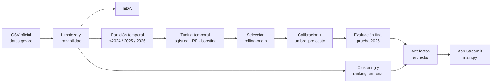
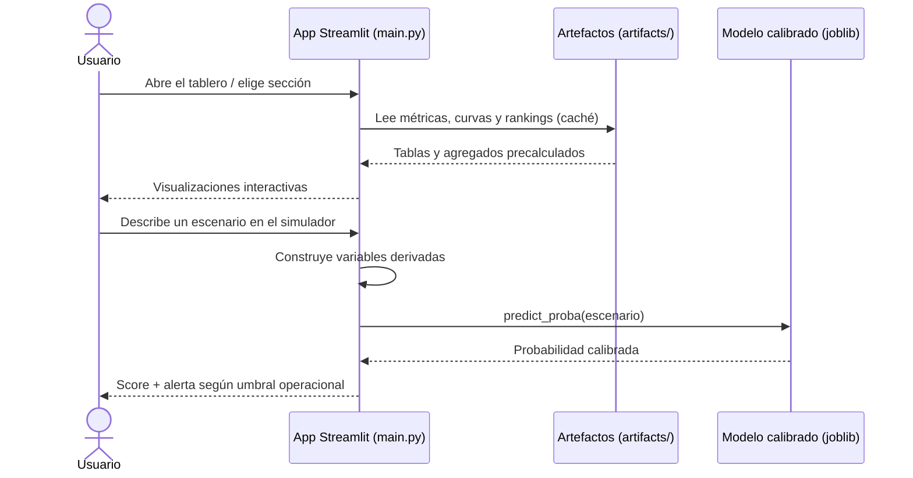

# 🚦 Gravedad de siniestros viales en Colombia (Ley 2251 de 2022)

> **Autores:** Miguel Cano ([@sal1n4x](https://github.com/sal1n4x)) ·
> **Curso:** Introducción a la Inteligencia Artificial ·
> **Fecha:** Noviembre de 2026

## 1. Introducción

En Colombia, los registros de vehículos involucrados en accidentes de tránsito
reportados bajo la Ley 2251 de 2022 superan los 450 mil entre 2022 y 2026, pero
solo ~5% corresponde a siniestros **con muertos**. Las autoridades de tránsito no
tienen capacidad para investigar con la misma profundidad todos los casos, de modo
que identificar temprano los registros con mayor probabilidad de ser fatales
permite priorizar investigación, fiscalización y recursos de prevención.

Este proyecto construye, con datos abiertos oficiales, (1) un clasificador
calibrado que prioriza registros según su probabilidad de corresponder a un
siniestro fatal bajo una capacidad operativa limitada de alertas, y (2) un análisis
descriptivo por territorio y tipo de vehículo (clustering y ranking con tasas
suavizadas) que orienta dónde mirar primero.

## 2. Objetivo

**Objetivo general:** priorizar los registros de vehículos involucrados en
siniestros viales según su probabilidad calibrada de corresponder a un accidente
con muertos, respetando una capacidad máxima de alertas del 10%.

**Objetivos específicos (medibles):**

1. Superar a la línea base de prevalencia en Average Precision sobre la prueba
   temporal 2026 (AP base = 0.086) con al menos 40% de recall de la clase fatal.
2. Entregar probabilidades calibradas con un Brier score ≤ 0.08 en la prueba 2026.
3. Producir un ranking territorial y una segmentación (clustering) reproducibles,
   con tasas suavizadas e intervalos de confianza del 95%, publicados en una
   aplicación Streamlit.

## 3. Descripción de los datos

- **Fuente:** [Vehículos involucrados en un accidente de tránsito — Ley 2251 de 2022](https://www.datos.gov.co/d/6jmc-vaxk)
  (RUNT, publicado en datos.gov.co). Descarga directa del CSV oficial.
- **Tamaño:** 450,335 registros × 9 columnas (2022–2026). Cada fila es un
  **vehículo involucrado**, no un accidente único (la fuente no publica un
  identificador de siniestro).
- **Licencia:** datos abiertos del Estado colombiano (Ley 1712 de 2014); uso
  permitido citando la fuente.

| Variable | Tipo | Descripción |
|---|---|---|
| `MARCA_VEHICULO` | Categórica (~100 niveles) | Marca reportada del vehículo |
| `MODELO_VEHICULO` | Numérica | Año modelo del vehículo |
| `TIPO_VEHICULO` | Categórica (~30 niveles) | Motocicleta, automóvil, camión, etc. |
| `EDAD_VEHICULO` | Numérica | Antigüedad reportada (años) |
| `FECHA_ACCIDENTE` | Fecha (MM/AAAA) | Mes y año del siniestro |
| `GRAVEDAD_ACCIDENTE` | **Objetivo** binario | `CON HERIDOS` (94.7%) / `CON MUERTOS` (5.3%) |
| `DEPARTAMENTO_ACCIDENTE` | Categórica (33) | Departamento del siniestro |
| `MUNICIPIO_ACCIDENTE` | Categórica (~1,100) | Municipio del siniestro |
| `AUTORIDAD_DE_TRANSITO` | Categórica | Autoridad que reporta |

**Preprocesamiento:** normalización de texto (mayúsculas, espacios), parseo de
fechas a año/mes, años modelo fuera de [1900, 2027] tratados como faltantes,
edades fuera de [0, 100] reconstruidas como `año − modelo` cuando es posible, hash
estable por registro para trazabilidad (`REGISTRO_ID`) y exportación a
`vehiculos_accidentes_limpio.csv`.

**Limitaciones y sesgos conocidos:** sin identificador oficial de accidente, la
unidad es el registro de vehículo (los siniestros multivehículo pesan más); no hay
datos de exposición (tráfico, parque automotor), por lo que las tasas no son
riesgo causal; la calidad del reporte varía por autoridad y territorio; 2026 solo
cubre parte del año.

## 4. Metodología

Etapas: (1) limpieza y trazabilidad; (2) EDA; (3) partición **temporal** —
entrenamiento ≤2024, validación 2025, prueba final 2026 intocada; (4) tuning de
hiperparámetros con cortes históricos (2022→2023, 2023→2024) maximizando
*Average Precision* sujeto a recall ≥ 40%; (5) selección de familia por validación
rolling-origin; (6) calibración (sigmoid vs isotónica, elegida por Brier en 2025)
y umbral operacional por costo esperado (FN = 5 × FP) con alertas ≤ 10%;
(7) clustering descriptivo y ranking territorial; (8) despliegue en Streamlit.

**Decisiones principales:** se comparan una regresión logística (referencia
interpretable), un Random Forest (no lineal clásico) y un HistGradientBoosting
con *target encoding* (alta cardinalidad de municipios/marcas). La métrica
principal es Average Precision porque la clase fatal es ~5%; la exactitud simple
sería engañosa. La partición temporal simula el uso real: entrenar con el pasado
y puntuar el futuro.



*Figura 1. Flujo metodológico: de los datos crudos a la aplicación.*

## 5. Diagrama de interacción (UML)

En producción, la aplicación Streamlit sirve los resultados precalculados y
puntúa escenarios nuevos con el modelo calibrado exportado por el notebook; no
reentrena nada en línea.



*Figura 2. Diagrama de secuencia del sistema en producción.*

## 6. Resultados

Métricas en la **prueba temporal 2026** (nunca usada para entrenar, seleccionar ni
calibrar), con umbral fijado en 2025:

| Modelo | ROC AUC | Average Precision | Brier | Recall fatales | Precisión fatales | Tasa de alertas |
|---|---|---|---|---|---|---|
| Línea base (prevalencia) | 0.500 | 0.086 | 0.080 | 0.000 | — | 0.0% |
| Regresión logística | 0.808 | 0.283 | 0.110 | 0.447 | 0.297 | 13.0% |
| Logística + interacciones | 0.809 | 0.283 | 0.109 | 0.450 | 0.295 | 13.2% |
| Random Forest | 0.802 | 0.263 | 0.267 | 0.442 | 0.281 | 13.6% |
| **Gradient Boosting (final, calibrado)** | **0.807** | **0.282** | **0.080** | **0.417** | **0.295** | **12.2%** |

Modelo final: **HistGradientBoosting + target encoding**, elegido por el mejor
objetivo operacional medio en validación rolling (2023–2025) y calibrado con
`sigmoid` (`cv=3`, `ensemble=False`), umbral operacional 0.049 fijado en 2025
(recall 41%, 9.8% de alertas, dentro de la capacidad). El clustering seleccionó
k = 5 perfiles departamento × tipo de vehículo, y el ranking territorial prioriza
municipios con tasas suavizadas e IC 95%.

**Análisis corto:** todos los modelos triplican con creces la línea base
(AP ≈ 0.086). El gradient boosting ganó la selección temporal sin usar 2026 y es
el único que combina ranking competitivo con probabilidades honestas
(Brier 0.080 frente a 0.110 de la logística); las logísticas siguen siendo
alternativas interpretables casi empatadas en AP, y el Random Forest quedó detrás
en ranking y calibración.
Limitaciones: la tasa de alertas en 2026 excede la capacidad definida en 2025
(indicio de *drift* que obliga a revisar el umbral antes de operar), no hay
variables de exposición ni de circunstancias del siniestro (vía, hora, clima), y
el techo de desempeño refleja que la gravedad depende de factores no observados.

## 7. Reproducibilidad

**Requisitos:** Python 3.12+ (probado con 3.14).

```bash
pip install -r requirements.txt
```

```bash
pip install jupyter
```

```bash
jupyter nbconvert --to notebook --execute --inplace main.ipynb
```

```bash
streamlit run main.py
```

El notebook descarga nada: el CSV oficial ya está en el repositorio. Al
ejecutarlo genera `vehiculos_accidentes_limpio.csv` y la carpeta `artifacts/`
que alimenta la aplicación.

**Estructura del repositorio:**

```
├── main.ipynb                  # Limpieza, EDA, modelado, clustering y exportación
├── main.py                     # Aplicación Streamlit (producción)
├── artifacts/                  # Métricas, curvas, rankings y modelo calibrado
├── .streamlit/config.toml      # Tema visual de la app
├── requirements.txt
├── README.md
└── VEHICULOS_INVOLUCRADOS_... .csv   # Datos crudos oficiales
```
